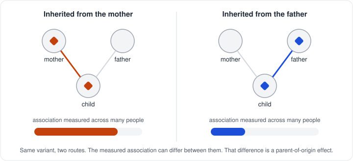

# evidence-agent

A second pair of eyes before a results paragraph leaves your desk. You give it a results table and a few draft sentences. It tells you which sentences to look at again, and why.

## The example field, in two sentences

For some DNA variants, the association with a characteristic can differ depending on whether the variant was inherited from the mother or the father. This is called a parent-of-origin effect, or POE.



The demo table is Table 1 of Hofmeister et al. (2025, *Nature*), a paper I co-authored: 30 such effects.

## One sentence, checked

The draft says:

> rs146982369 showed a genome-wide significant parent-of-origin effect on total protein level.

The table says:

| Inherited from | Estimate | Standard error |
| --- | --- | --- |
| mother | -0.106 | 0.032 |
| father | 0.101 | 0.032 |

P-value for the mother-father difference: 2.59e-6.

- The **estimate** is in standard deviations of the trait. -0.106 is about a tenth of a standard deviation lower, not 10.6% lower.
- The **standard error** is its uncertainty.
- The **p-value** says how surprising the difference would be if there were none. "Genome-wide significant" is a strict convention: below 5e-8.

The checker returns:

| | |
| --- | --- |
| Finding | Contradicted |
| Why | "...a reported p-value for the parent-of-origin difference of 2.59e-06, which does not meet the genome-wide significance threshold of 5e-08." |
| Source | rs146982369_total_protein_level (Total protein level, effect allele G): maternal -0.106 (SE 0.032, P 0.000999); paternal 0.101 (SE 0.032, P 0.00188); difference P 2.59e-06 |
| What to do | Revise the significance wording. The reported p-value does not meet the stated threshold. |

The finding is about the wording. It does not say there is no effect.

## Who does what

The language model reads the sentence and picks the checks. Python looks up the row and does the arithmetic and the comparisons. The source column is copied from your table, not from the model.

It checks quoted numbers, effect direction, significance wording and mother-father differences. It does not understand biology: sentences about mechanism come back marked for you.

## Does it help?

A pilot on 14 sentences, 9 with a problem. I reviewed the expected findings before the run.

| Problems caught | False alarms | Right source row | Model time |
| --- | --- | --- | --- |
| 8 of 9 | 0 of 5 | 14 of 14 | 51 s |

The miss: it accepted "specific to the maternally inherited allele", which a non-significant paternal estimate cannot show. Reading time was not measured and nothing was compared with checking by hand, so no time saving is claimed. See [pilot/README.md](pilot/README.md).

Is this better than simply asking the model? On accuracy, not so far: 26 of 32 benchmark claims right with tools, 23 without, and the difference is not significant. What the tools removed was misjudged p-value thresholds and numbers taken from the wrong row. The model's prose still slips. In one demo sentence it wrote that 2.22e-7 is below 5e-8; the finding was right because Python made the comparison.

## Try it

```bash
python -m venv .venv
source .venv/bin/activate          # Windows: .venv\Scripts\Activate.ps1
pip install -r requirements.txt
python -m pytest                   # offline, no API key needed

cp .env.example .env               # add an OpenAI key
python -m evidence_agent review --statements examples/statements.txt
python -m evidence_agent review --statements my_sentences.txt --records my_table.csv
```

One sentence per line. The table needs the columns of `data/poe_published/records.csv`.

## Before you trust it

- Small demo sets, on the one table the tool was developed with.
- The labels of the two earlier benchmarks are provisional: no expert has reviewed them, and one decision rule was already found wrong and corrected.
- After that correction the saved outputs were re-scored. The corrected code has been run with the model only on the pilot.

More: [methods](docs/METHODS.md), [all results](docs/RESULTS.md), [corrections](docs/CHANGELOG.md).

Roya Karimi, University of Bergen. MIT licence ([LICENSE](LICENSE)). Table 1 reused under [CC BY 4.0](https://creativecommons.org/licenses/by/4.0/), [doi:10.1038/s41586-025-09357-5](https://doi.org/10.1038/s41586-025-09357-5).
